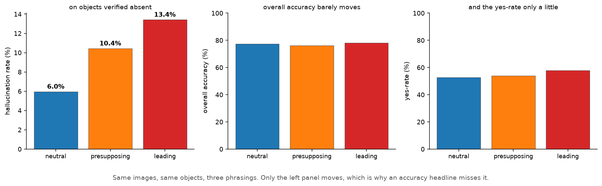
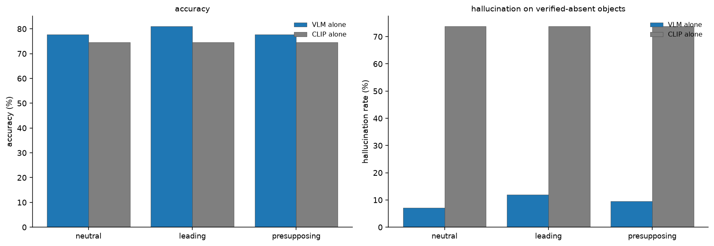
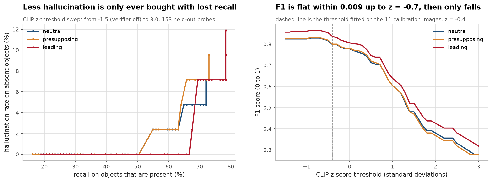
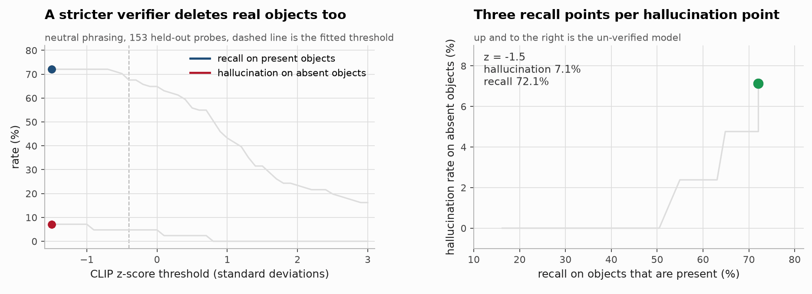
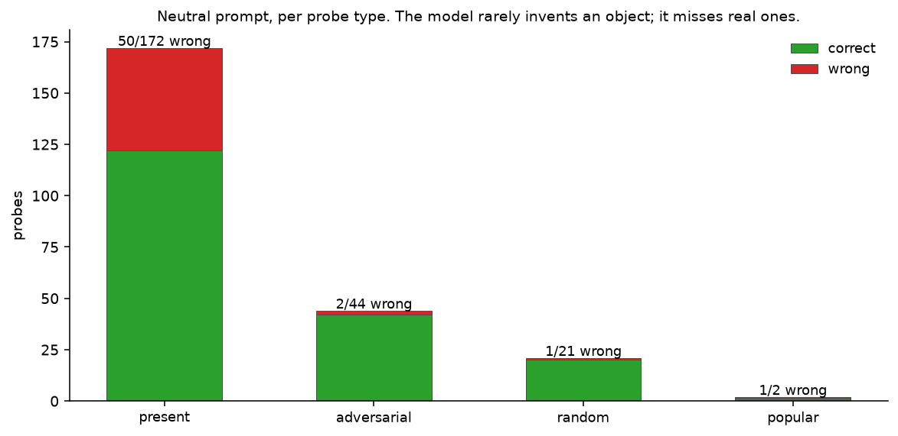

# Hallucination-aware captioning, with an adversarial set I built by hand

[](https://github.com/aghasalim/vlm-hallucination-eval/actions/workflows/ci.yml)
[](https://github.com/aghasalim/vlm-hallucination-eval/actions/workflows/demo.yml)
[](https://www.python.org/)
[](LICENSE)
[](https://doi.org/10.5281/zenodo.23003687)

**[▶ Live demo](https://vlm-hallucination-eval.streamlit.app/)**. You can upload
an image or pick one from the adversarial set and see a grounding score for each
claim.

This is a vision-language system that captions images and answers questions
about them. On top of it I added a CLIP-based layer that checks whether each
claim is really in the image. I also built an adversarial evaluation set by hand
to catch the cases where it isn't.

I went in expecting a model that confidently describes things that aren't there,
since that's what the papers say vision-language models do. I found the
opposite, and I think what I found is more interesting.

---


---

## Abstract

People usually report vision-language hallucination as one rate on a fixed
benchmark. I wanted to know how much of that number comes from the way the
question is asked. To test it I used object-presence probes on MS-COCO images,
with ground truth I checked by hand, and asked the same question in three
different ways.

Overall accuracy barely changes. In other words, accuracy is nearly invariant to phrasing, 77.4%, 76.2%, 78.2% for
neutral, presupposing and leading. But on objects I verified are not in the
image, the hallucination rate more than doubles across the same three, from 6.0%
to 13.4%. Sneaking the object into the question mattered more than any model
change I tried, and if you only look at accuracy you'd never see it.

Next I added a CLIP-based verifier as a second opinion. On its own it's less
accurate than the VLM, and the combination has even lower recall. The upside
is that it cuts the hallucination rate by 25 to 40% relative, 25% on presupposing phrasing, 33% on
neutral and 40% on leading. That's the only reason to use it. In absolute
terms the whole range is 1 to 2 fewer false positives out of 42 verified-absent probes, so I wouldn't read much into where in the range a given
phrasing falls. I report the full trade-off curve, because the right threshold
depends on whether missing an object or inventing one costs you more.

What's in the repo:

- A probe set with objects I verified are absent, so hallucination is measured
  against real ground truth.
- A phrasing ablation that separates the effect of the prompt from the effect of
  the model.
- A verification cascade reported as a trade-off curve, showing what it costs
  next to what it gains.

---

## 1. Findings
With a neutral prompt the model rarely invents an object that isn't there. Its usual mistake is missing objects that are.







*Only the CLIP z-score threshold changes between frames. The model, the held-out probes and the neutral phrasing stay the same, so the recall you see dropping is the price of the lower hallucination rate.*



Detail in [notes/METHODS.md](notes/METHODS.md#1-findings).

### A corrected figure

This README used to say hallucination can be pushed to exactly zero "at a cost
of roughly 29 points of recall". I took that from the z = 1.0 row of the sweep.
But hallucination first hits exactly zero at z = 0.8, and that only costs 21.6
points instead of 29. The table in [notes/METHODS.md](notes/METHODS.md) went straight from
0.5 to 1.0 and skipped the row where zero starts, which made the trade look
worse than it is. Both documents now say 22 points, and I added the 0.8 row to
the table.
## 2. The evaluation set
I labelled 33 images, **172 objects verified present and 67 verified absent** (44 of them adversarial), so 239 yes/no probes in total.

Detail in [notes/METHODS.md](notes/METHODS.md#2-the-evaluation-set).
### Two things this caught

Doing it by hand caught a bug that would have quietly broken every number.
"plate" isn't one of COCO's 80 categories. My list of easily confused objects
included it, so every image would have looked like it had no plate. I would have
been measuring COCO's label vocabulary and calling it hallucination. Now there's
[a test](tests/test_eval_set.py) that fails if any probe falls outside the 80.

It also made me admit a limit on the scope, which is the first point below.

---

## 3. Limitations

- The set leans towards scenes where I could be sure. To use absence as ground
  truth I have to be certain the object isn't there. That's hardest in cluttered
  indoor scenes, which is where VLMs fail most. For example, I dropped cutlery
  probes in kitchens because a fork could be anywhere. So the rates here are
  probably too optimistic, since the images I threw out are the ones that would
  have hurt the model most.
- I only tested one model family. BLIP is an encoder-decoder trained on VQA. The
  papers that got me interested in this mostly study LLaVA or MiniGPT style
  models, where the language prior can override the image. So please don't take
  this as "VLMs don't hallucinate". It's more like "this model, on these images,
  behaves differently".
- The numbers are small. There are 153 probes over 22 held-out images, 42 of them verified-absent.
  4.8% is two errors, so I'd ignore differences of a percentage point or so.
- The `popular` probe split has only 2 verified items. I only include it so
  nothing is left out.

---

## 4. Running it

```bash
make setup && make data && make evalset
```

```bash
make baseline && make verify && make report
```

That reproduces every number above. You don't need an API key or any paid
service. BLIP and CLIP run locally on CPU (or Apple MPS), and the full evaluation
takes about 4 minutes on a laptop. Separate implementations in `verify/`
recompute every published figure from the per-probe records, and CI fails if any
of them disagree.

```bash
make app
```

You can also build the container. It includes the weights, so a cold start
doesn't spend a minute downloading them.

```bash
docker build -t vlm-hallucination-eval . && docker run -p 8501:8501 vlm-hallucination-eval
```

---

## 5. Method
I used beam search instead of sampling, because I wanted a hallucination rate that stays the same between runs.

Detail in [notes/METHODS.md](notes/METHODS.md#5-method).

## 6. Licence

MIT, see [LICENSE](LICENSE). I don't redistribute COCO images here. `make data`
downloads them from cocodataset.org. `data/eval_set.json` only has image ids and
my own annotations.

## References

These are the papers the metric, the probe design and the three models come from.

- **Rohrbach, Hendricks, Burns, Darrell, Saenko. Object Hallucination in Image Captioning. EMNLP 2018.** [arXiv:1809.02156](https://arxiv.org/abs/1809.02156) the CHAIR metric and the framing of object hallucination.
- **Li, Du, Zhou, Wang, Zhao, Wen. Evaluating Object Hallucination in Large Vision-Language Models. EMNLP 2023.** [arXiv:2305.10355](https://arxiv.org/abs/2305.10355) POPE, the polling based evaluation.
- **Radford, Kim, Hallacy et al. Learning Transferable Visual Models From Natural Language Supervision. ICML 2021.** [arXiv:2103.00020](https://arxiv.org/abs/2103.00020) CLIP.
- **Li, Li, Xiong, Hoi. BLIP: Bootstrapping Language-Image Pre-training. ICML 2022.** [arXiv:2201.12086](https://arxiv.org/abs/2201.12086) BLIP.
- **Liu, Li, Wu, Lee. Visual Instruction Tuning. NeurIPS 2023.** [arXiv:2304.08485](https://arxiv.org/abs/2304.08485) LLaVA.
